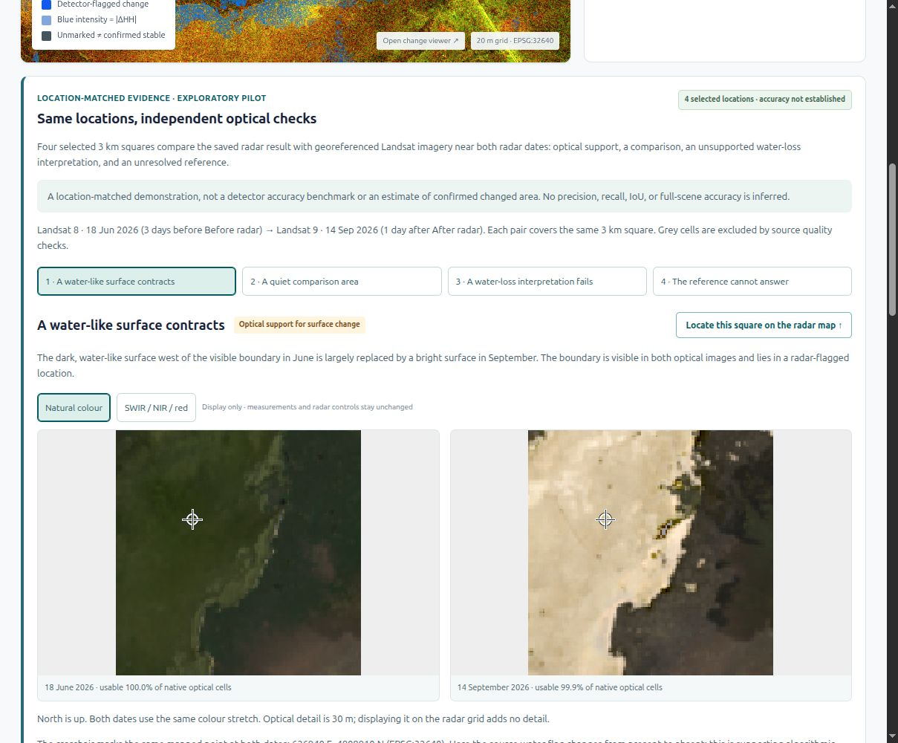

# Location-matched optical pilot

This is an exploratory evidence pilot for `sample-0893b8c3af904967`, not a detector
accuracy benchmark. Four deliberately selected, non-overlapping 3 km squares
compare the saved radar result with independently acquired Landsat observations.
The pilot contains optical support, a quiet comparison, a failed water-loss
interpretation, and a reference-quality failure. It does not establish detector
precision/recall, IoU, confirmed changed area, or geographic generalization.



## Reference acquisitions

| Role | Public source item | Radar date | Gap |
| --- | --- | --- | --- |
| Before | [Landsat 8, 18 June 2026](https://planetarycomputer.microsoft.com/api/stac/v1/collections/landsat-c2-l2/items/LC08_L2SP_162030_20260618_02_T1) | 21 June 2026 | 3 days before |
| After | [Landsat 9, 14 September 2026](https://planetarycomputer.microsoft.com/api/stac/v1/collections/landsat-c2-l2/items/LC09_L2SP_162030_20260914_02_T1) | 13 September 2026 | 1 day after |

The source images are USGS Landsat Collection 2 Level-2 surface reflectance,
accessed through Microsoft Planetary Computer. These are separate acquisitions
from the June 27 / September 23 regional-report maps. Scene-wide cloud percentages
are not used as a substitute for local pixel-quality checks.

## What the four locations show

| Site; EPSG:32640 west/south/east/north, metres | Observation | Interpretation limit |
| --- | --- | --- |
| `contraction`; 626000 / 4807000 / 629000 / 4810000 | Dark water-like cover is largely replaced by bright cover along a matching boundary. Usable reference coverage: 100.0% / 99.9%. | Supports a local surface-change interpretation near the radar dates, not the cause or every flagged pixel. |
| `reference`; 596000 / 4768000 / 599000 / 4771000 | Similar terrain and linear features at both dates; no visible saved flags; local median HH difference +0.09 dB. | An appearance-stable comparison at 30 m, not proof of no physical change or a complete binary unflagged mask. |
| `bright-surface`; 554000 / 4789000 / 557000 / 4792000 | Strong radar change and visible flags over bright surfaces. Positive MNDWI does not agree with the source water flag, which is absent at both dates. | A water-loss claim is unsupported. This is an interpretation failure, not a demonstrated generic-detector false positive. Material/cause remains unresolved. |
| `quality-blocked`; 545000 / 4804000 / 548000 / 4807000 | September quality checks leave only 7.91% usable reference cells. | Unresolved; do not assign a changed/unchanged truth label. Grey marks excluded reference cells. |

Review status is **AI-assisted exploratory visual inspection**, without independent
human or field review. Sites were chosen after inspecting the radar overlay,
optical imagery, quality masks and an exploratory index. They are neither random
nor blind nor a held-out test set. Their outcomes are not counted as true/false
positives or negatives.

In the contraction example, the crosshair marks the same mapped point
(626940 E, 4808910 N, EPSG:32640) in the radar and optical crops. The original
reference QA water flag is present in June and absent in September at that point,
and its MNDWI changes from approximately 0.992 to −0.041. This is supporting
algorithmic evidence at an explicitly located point, not independently reviewed
ground truth. The point was selected during exploration, not sampled blindly.

## Spatial and measurement methods

- Original radar products are verified against the full SHA-256 values in the
  saved sample manifest before extraction. All radar measurements are recomputed
  from their native power arrays at 20 m spacing. Local HH/HV values are medians
  of paired After − Before differences across every valid cell in the square.
- Both radar and optical sources use EPSG:32640. The two optical crops share their
  original 30 m grid. Optical statistics use native cell centres inside each
  square (10,000 cells), rather than upsampled display pixels. Native raster edges
  can differ from the requested square by less than half a reference cell.
- Optical display images are reprojected by nearest neighbour onto the exact
  150 × 150 radar crop grid. Both dates share reflectance range 0–0.6 and exponent
  0.7. Natural colour is red/green/blue; false colour is SWIR1/NIR/red. This adds
  no optical detail. Shared coordinates are not a separate measurement of
  physical subpixel co-registration accuracy.
- QA_PIXEL bits 0–5 exclude fill, dilated cloud, cirrus, cloud, shadow and snow.
  Any QA_RADSAT flag or zero reflectance DN also excludes a cell. Excluded cells
  are grey. Surface reflectance is DN × 0.0000275 − 0.2.
- MNDWI is (green − SWIR1) / (green + SWIR1), for positive denominators. The
  diagnostic cutoff 0.15 is illustrative, not a validated water classifier.
  QA_PIXEL bit 7 supplies a separate source water diagnostic. Neither algorithm
  is treated as ground truth, particularly over bright surfaces.
- The historic bundle contains an alpha-weighted overlay, not the complete
  detector mask. Nonzero alpha is a **lower bound** on the original flags:
  sufficiently small HH differences can round to zero alpha. All displayed flag
  fractions in this pilot are explicitly labelled as visible-overlay fractions.

Methods references: [USGS QA bands](https://www.usgs.gov/landsat-missions/landsat-collection-2-quality-assessment-bands),
[USGS reflectance scaling](https://www.usgs.gov/faqs/how-do-i-use-a-scale-factor-landsat-level-2-science-products),
[Microsoft reference-data access](https://planetarycomputer.microsoft.com/docs/concepts/sas/).

## Included portable evidence

[`karakalpakstan-pilot/manifest.json`](karakalpakstan-pilot/manifest.json) records
source IDs/dates, exact bounds and centres, metrics, interpretation limits and
artifact SHA-256 values. [`sites.csv`](karakalpakstan-pilot/sites.csv) is a concise
summary; every row states `is_ground_truth=false`.

`source/` contains the original public STAC metadata, eight cropped seven-band
GeoTIFFs, and four compact radar-array snapshots. GeoTIFF band order is red,
green, blue, NIR, SWIR1, QA_PIXEL, QA_RADSAT; values remain original unsigned
16-bit DN/QA values. Radar NPZ keys are `t0_db`, `t1_db`, `paired_valid`, and
`overlay_alpha`. The app serves the optical GeoTIFFs for download and includes
the pilot in its measurements JSON and Markdown/plain-text reports. No network
or new scientific dependencies are needed for ordinary saved playback.

## Audit without full source products or weights

In an environment with the project's normal analysis dependencies:

```bash
python -m unittest tests.samples.test_matched_evidence -v
```

For the additional native-GeoTIFF and quality-mask audit:

```bash
python -m pip install -r evaluation/requirements.txt
python -m unittest discover -s evaluation -p test_pilot.py -v
```

These verify artifacts, geometry and calculations; they are software/provenance
checks, not evidence of scientific detection accuracy.

## Rebuild from source

With the evaluation dependencies installed and the two original GCOV files
available in a source directory:

```bash
python evaluation/fetch_landsat.py --out /tmp/nisar-landsat
python evaluation/build_matched_evidence.py \
  --source-dir /path/to/original-gcov-pair --landsat-cache /tmp/nisar-landsat
```

The fetch uses public metadata and temporary read-only access tokens; no token
is stored in the repository. Original acquisition IDs and site definitions are
fixed in the scripts and `sites.json`. Rebuilding writes the pilot artifacts;
it does not rerun the detector or modify the immutable saved sample.
